# mrc-vs-rail

> **Disclaimer** - this is my best attempt to mimic MRC in a virtual lab. Real MRC lives in NIC hardware and detects a dead path within microseconds. Here the NIC is a small self-made Python app, so I call it mrc-style. Everything runs on veth links in containerlab, far from real hardware timing.

After reading about OpenAI's MRC I wanted to see how the idea behaves next to a classic rail-optimized fabric. Write-up : [punt2cpu.net](https://punt2cpu.net/2026/10/26/mrc-vs-rail-lab/)

## Run it yourself

```bash
git clone https://github.com/punt2cpu/mrc-vs-rail.git && cd mrc-vs-rail
sudo ./lab.sh all
```

Installs docker and containerlab if missing, builds the image, runs both labs and all tests. Needs kernel 6.1 or newer, Ubuntu 24.04 works. `./lab.sh watch rail` in a second terminal shows the QPs live.

Faster detection on both sides, mrc probes every 2 ms and rail BFD at 10 ms x3 (the FRR minimum) :

```bash
sudo PROBE_MS=2 BFD_MS=10 ./lab.sh all
```

Results of such runs get their own name (`rail-link-bfd10`, `mrc-link-probe2`), so they don't mix with the default ones.

## The two labs

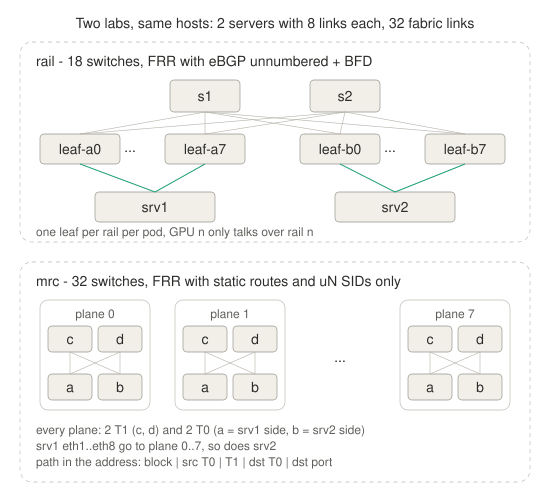

- rail - 18 FRR switches, eBGP unnumbered, BFD 50 ms x3, per-flow ECMP. A server is 8 GPUs with one NIC each, GPU n talks to GPU n over rail n

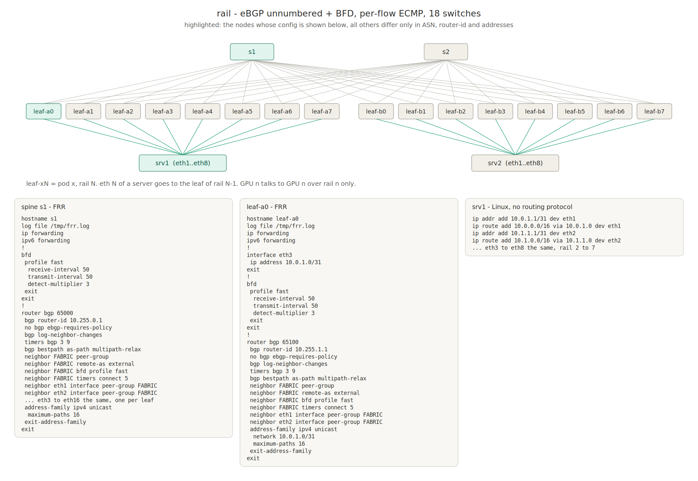

- mrc-style - 32 FRR switches with static routes and one uN SID each, no routing protocol. A server is one NIC split into 8 ports, one per plane. The host writes the whole path into the IPv6 destination address, every switch shifts 16 bits and forwards

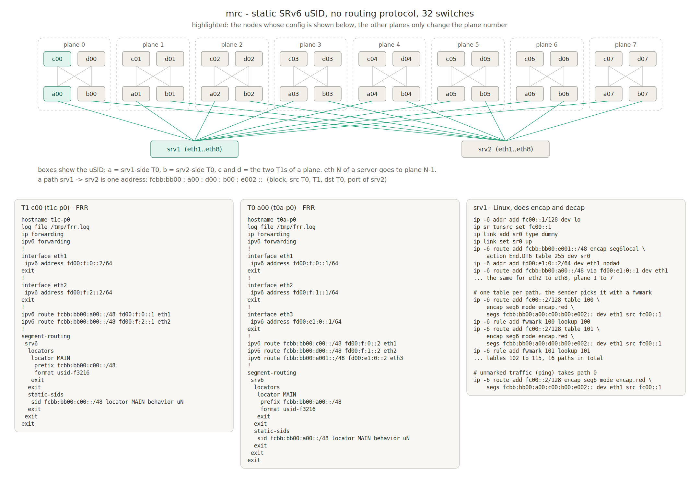

Config of every device, with its links, FRR and Linux part : [configs/rail](configs/rail) and [configs/mrc](configs/mrc).

The Python app sends every packet on the next of 16 paths and probes each path every 50 ms. 3 lost probes in a row and the path is dropped, about the same budget as BFD on the rail side. Traffic is 32 QPs from srv1 to srv2, 1000 packets per second each, so 1 lost packet = 1 ms of that QP.

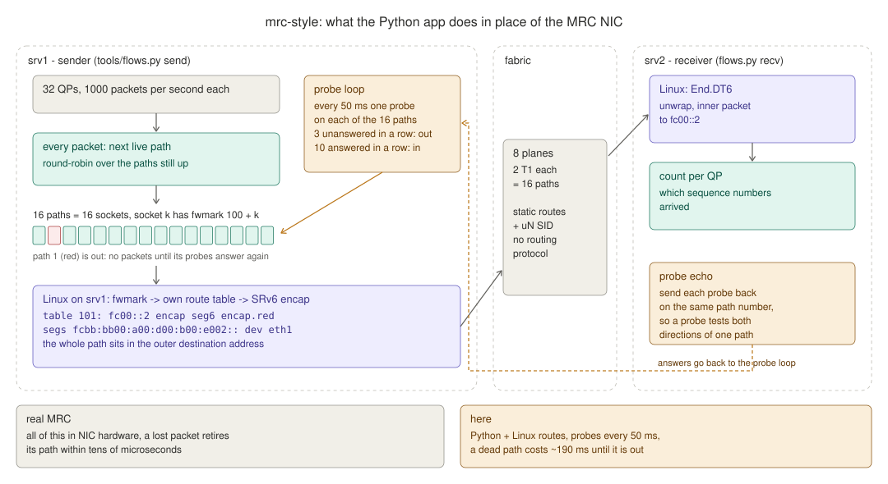

## First runs

The first version had only spray (no outage), link (link drops traffic) and switch (switch control plane up, but the device drops 100% of its traffic).

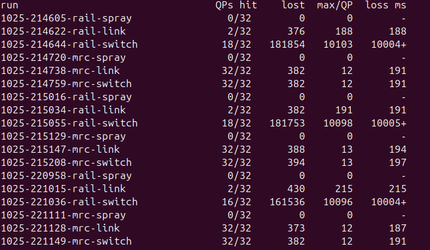

What caught my eye : in link both lose about the same in total, but rail puts it all on 2 QPs. In switch rail lost half the QPs for the full 10 s every time, mrc-style had a ~190 ms blip. So I added two more fault scenarios.

## The tests

- **spray** - no fault, where does the traffic go
- **link** - a T0-T1 link drops everything for 10 s, link stays up
- **switch** - a T1 stops forwarding, BGP and BFD keep running on it
- **flap** - the same link loses carrier for 2 s every 10 s, four times
- **t0down** - a whole T0 goes down for 10 s

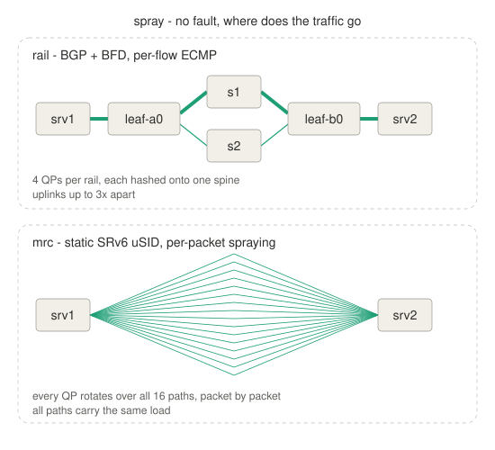
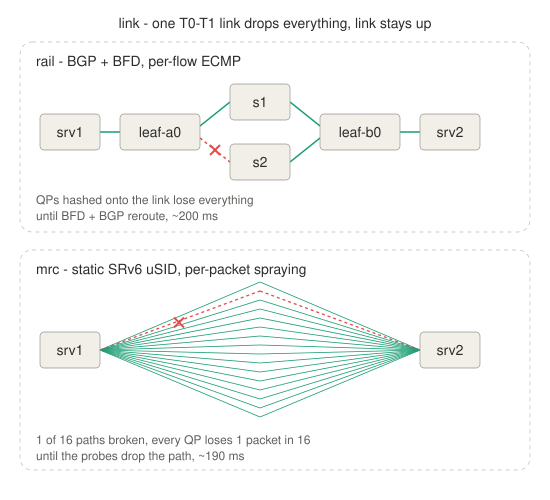
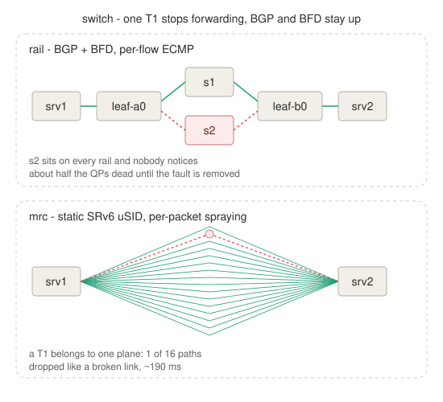
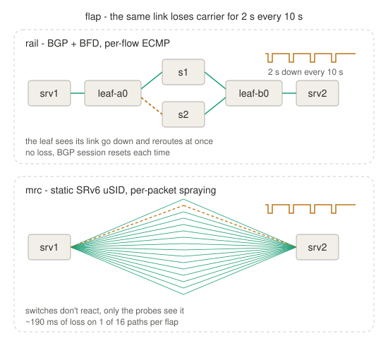
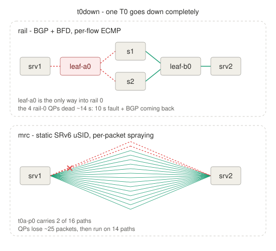

## Results

11 runs, median :

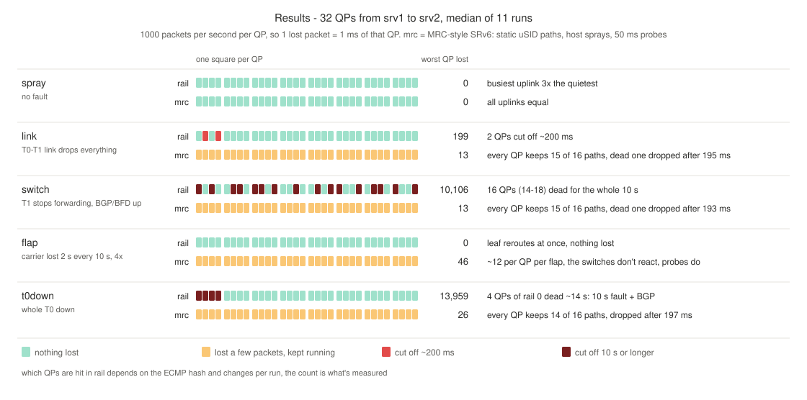

Lab env. probe interval for MRC is 50 ms. I assume on real h/w, where probes are generated on the NIC level, fault path detection would happen much faster and result in less dropped traffic.

## Conclusions

- the main difference is how traffic is spread. In mrc-style every QP is sprayed over all 16 paths, so a link, a T1 or a T0 only carries a slice of each QP. Losing one costs every QP a few packets, which MRC resends selectively. In rail a link, spine or leaf carries whole QPs, so losing one cuts those QPs off completely - 2 QPs for a link, half of them for a spine, a whole rail for a leaf
- flap goes to rail (but only due to virtual lab env. restrictions). The leaf sees carrier loss and moves traffic at once, in mrc-style we wait for the host probes, ~190 ms per flap
- all of this with a Python app probing every 50 ms and UDP instead of RDMA, so retransmits aren't in the numbers. Real MRC detects per packet in the NIC within microseconds
- quite impressive to see the capabilities of the SRv6 approach here

## What this virtual env. lab test doesn't show

- RDMA - traffic is UDP, lost packets are counted, retransmits aren't modelled
- congestion, buffers, PFC, incast, trimming
- real timing - software forwarding on veth, milliseconds at best

## License

MIT
